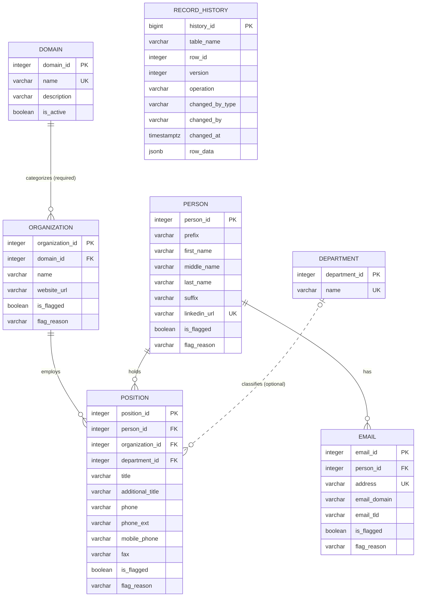

# Client Tracking Database

PostgreSQL database for storing client contact records, hosted on **Neon** and used by the app running on **Cloudflare**.

The original flat contact record (organization, name, title, phones, email, domain, etc.) is split into normalized tables so that each fact is stored once, every record is versioned, and every change is kept in a history table.

**Ticket:** CHUD-10

---

## Files

| File | Purpose |
|---|---|
| `database_schema.sql` | Creates all tables, indexes, and the versioning/history triggers. Run once on a fresh database. |
| `database_add_flag_columns.sql` | Migration that adds `is_flagged` and `flag_reason` to the record tables. Run after `database_schema.sql`. Safe to rerun. |
| `CTI - ERD.pdf` | Original ERD (V1) of `database_schema.sql`, created in [dbdiagram.io](https://dbdiagram.io). |
| `CTI - ERD flag additionV2.pdf` | Updated ERD (V2) including the `is_flagged` / `flag_reason` columns from `database_add_flag_columns.sql`. |

---

## Tech

- **Database:** PostgreSQL, hosted on Neon
- **Schema language:** SQL (PostgreSQL dialect), triggers written in PL/pgSQL
- **App connection:** Cloudflare connects to Neon using the Neon connection string (stored as a Cloudflare secret, never in the repo)

---

## Entity Relationship Diagram

The current ERD is [`CTI - ERD flag additionV2.pdf`](CTI%20-%20ERD%20flag%20additionV2.pdf), which includes the flag columns added by `database_add_flag_columns.sql`. The original V1 diagram of `database_schema.sql` is kept in [`CTI - ERD.pdf`](CTI%20-%20ERD.pdf) for reference. A summary of the current design is below.



`record_history` has no lines to the other tables on purpose: it points at any table by `table_name` + `row_id` rather than by foreign key.

---

## Tables

| Table | What it stores |
|---|---|
| `domain` | Business sectors (e.g. Technical, EMS, Transportation). Users pick an existing domain or add a new one. |
| `department` | Optional department names (e.g. Finance). |
| `organization` | Companies and agencies. Each has exactly one domain. |
| `person` | People's names and LinkedIn profile. |
| `position` | **The contact record**: one person at one organization, with their title, department, and phone/fax numbers. |
| `email` | Email addresses for a person, with the email domain and top-level domain entered alongside. |
| `record_history` | A snapshot of every insert, update, and delete on the tables above. |

### Mapping from the original record fields

| Original field | Stored in |
|---|---|
| domain | `domain.name` → `organization.domain_id` |
| organization, website_url | `organization` |
| prefix, first/middle/last name, suffix, linkedin_profile | `person` |
| title, additional_title, department | `position` (department via `department` table) |
| phone_number, phone_ext, mobile_phone, fax | `position` |
| email, email_domain, email_tld | `email` |
| date_created, date_last_updated | audit columns on every table |

---

## Audit columns, versioning, and history

Every table except `department` and `record_history` has these columns:

| Column | Meaning |
|---|---|
| `date_created` | When the row was first stored |
| `date_last_updated` | When it last changed (set automatically) |
| `last_verified_at` | When the record was last confirmed correct (set on create, on every manual save, and when the refresh confirms the record) |
| `updated_by_type` | `USER` or `REFRESH` (automatic web refresh) |
| `updated_by` | Username, or the refresh job's name |
| `version` | Starts at 1 and goes up by 1 on every update that changes a value (set automatically) |

Two trigger functions handle this automatically:

- **`trg_bump_version()`** runs before every update and increments `version` and sets `date_last_updated`.
- **`trg_write_history()`** runs after every insert, update, and delete and copies the full row (as JSON) into `record_history`, along with who made the change.

`database_add_record_versions.sql` (CHUD-36) refines both: an update that changes nothing, or only
`last_verified_at`, keeps the same version, last updated date and `updated_by`, and writes no history row.
So a manual save with no changes, or a refresh that confirms a record is still correct, only moves `last_verified_at`.
The saved versions are read back newest first by `GET /api/organizations/:id/history` and `GET /api/people/:id/history`.

### Flagging

`organization`, `person`, `position`, and `email` also have:

- `is_flagged` (default `false`) to mark a record for review
- `flag_reason` to say why

Flagging is a normal update, so it bumps the version and is saved in history.

---

## Rules enforced by the database

- Every organization must have a domain (`domain_id` is required).
- Domain and department names are unique ignoring case and spaces (`EMS` and ` ems ` count as the same).
- Names (`domain`, `department`, `organization`, `first_name`, `last_name`) cannot be blank or only spaces.
- `email.address` must be unique, lower-case, and contain `@` and a dot.
- `linkedin_url` must be unique.
- `updated_by_type` must be `USER` or `REFRESH`.

---

## Setup (Neon)

1. Open the Neon console, select the project and the correct **branch**.
2. Open the **SQL Editor**.
3. Run `database_schema.sql` **once**.
4. Run the add-on files in this order:
   1. `database_add_flag_columns.sql` (flags, CHUD-10)
   2. `database_add_website_discovery.sql` (website status and candidates, CHUD-30)
   3. `database_add_search_usage.sql` (web search log, CHUD-49)
   4. `database_add_record_versions.sql` (no version for unchanged saves, last verified date, CHUD-36)

From a terminal instead:

```bash
psql "<neon connection string>" -f database_schema.sql
psql "<neon connection string>" -f database_add_flag_columns.sql
psql "<neon connection string>" -f database_add_website_discovery.sql
psql "<neon connection string>" -f database_add_search_usage.sql
psql "<neon connection string>" -f database_add_record_versions.sql
```

The add-on files are safe to run again on a database that already has them.

Running `database_schema.sql` a second time fails because the tables already exist. Later changes should be added as new migration files.

---

## Notes for app / endpoint developers

- **Set the audit fields on every write.** Include `updated_by` (and `updated_by_type = 'REFRESH'` for automated refreshes) on each insert and update so history records who made the change.
- **Deletes:** run `SET LOCAL app.changed_by = '<username>'` in the same transaction before a `DELETE` so history records who deleted the row.
- **Domains:** list active domains with
  ```sql
  SELECT domain_id, name FROM domain WHERE is_active ORDER BY name;
  ```
  To add a new one, insert into `domain` and use the returned `domain_id`. If the insert fails as a duplicate, select the existing domain instead.
- **Emails:** lower-case the address before saving, or the insert will be rejected.
- **Schema changes:** don't edit tables directly in Neon. Add a new migration `.sql` file to the repo (like `database_add_flag_columns.sql`) so everyone's database stays in sync.

---

## Work log

| Date | Work | Time |
|---|---|---|
| 10/13 | Initial research and collection of information for database design | 1hr |
| 10/14 | Initial creation of ERD | 2hr |
| 10/15 | Completion of ERD and `database_schema.sql` | ~3hr |
| 10/18 | Added `is_flagged` / `flag_reason` migration (PR #5) and updated the ERD to V2 | |

---

## AI Usage Statement

**AI used:** Yes

**Tool & model:** Claude (Anthropic), via claude.ai. Model: claude-opus-5-5.

**How it was used:**
- Discussing how to normalize the original flat record into separate tables and designing the ERD.
- Explaining database concepts (normalization, primary/foreign keys, indexes, CHECK constraints, triggers, PL/pgSQL) and tools (Neon, Cloudflare, dbdiagram.io, Git/GitHub pull requests and code review).
- Reviewing my SQL for syntax errors and testing it against a test PostgreSQL database.
- Providing example SQL, DBML, and migration scripts to learn from and compare against.
- Suggesting Git/GitHub workflow steps and wording for commit messages and the pull request.
- Drafting this README, which was then reviewed and edited.

**Data shared with AI:** Only client-approved sample data (screened by the client, confidential information removed) was shared with the AI. No credentials, connection strings, or production data were shared.

**My work:** I did not copy and paste AI-generated code into `database_schema.sql`, `database_add_flag_columns.sql`, or the ERD, and I did not give the AI access to edit my files. I read, reviewed, and made sure I understood every suggestion, then typed all of my code by hand in VS Code and Neon. I made the final design decisions, accepting, changing, or rejecting the AI's suggestions. Decisions that were my own include requiring one domain per organization with select-or-add domains, storing phone, extension, mobile, and fax as entered fields, making department optional, and leaving out start and end dates. I tested and verified all final files myself. 
