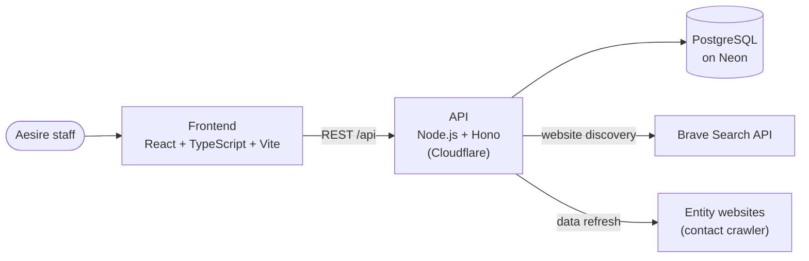
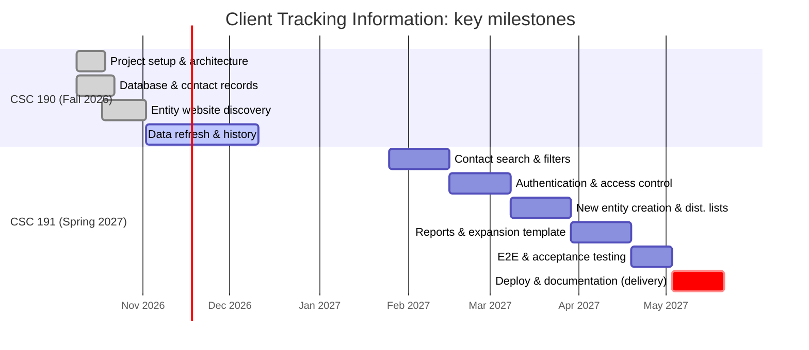

<p align="center">
  <!-- Logo: add docs/images/logo.png, then uncomment the next line and delete the placeholder line. -->
  <!--  -->
  <em>[ Team logo goes here: docs/images/logo.png ]</em>
</p>

<h1 align="center">Client Tracking Information</h1>

<p align="center">
  <strong>Keeping public-agency contact records accurate, automatically.</strong><br>
  Team CHUD · California State University, Sacramento · CSC 190/191 Senior Project · for Aesire LLC
</p>

---

## Contents

- [Synopsis](#synopsis)
- [Features](#features)
- [Prototype](#prototype)
- [Architecture](#architecture)
- [Data model](#data-model)
- [Repository layout](#repository-layout)
- [Developer instructions](#developer-instructions)
- [Testing](#testing)
- [Deployment](#deployment)
- [Timeline](#timeline)
- [About the project](#about-the-project)
- [AI use](#ai-use)

---

## Synopsis

Aesire LLC partners with consulting firms to provide IT services to the State of California. As part of that work it
keeps contact databases for public agencies and special districts across the state, such as fire districts and water
districts. Today those records are kept up to date by hand. That is slow, and records go stale as people change roles
or organizations.

**Client Tracking Information** is a web application that replaces that manual work. It:

- **finds each entity's official website** with a web search, ranks the results and saves the best match (or asks a
  person to choose when it isn't sure);
- **refreshes contact information** on demand, one record at a time, from each entity's website, updating records in
  place without creating duplicates;
- **keeps a full history**: every change is saved as a new version with the time and whether a person or the
  automatic refresh made it, and records are **flagged, never deleted**;
- lets staff **search** for contacts across California for emergency response, outreach and information distribution
  (CSC 191).

The data model is built so that new fields of work and industries (for example healthcare or transportation) can be
added later without redesigning the application.

---

## Features

Features come from the project charter (section 2.3) and the team's Jira epics.

| Feature | What it does | Jira | Status |
|---|---|---|---|
| Project setup & architecture | Repo, branching strategy, tech stack, dev environments, wireframes | CHUD-2 | ✅ Done |
| Database & contact records | Normalized schema, client test data import, REST API, records list, edit forms with validation | CHUD-3 | ✅ Done |
| Entity website discovery | Web search by entity name, ranking, auto-save of confident matches, review screen for unsure ones | CHUD-6 | ✅ Done |
| Data refresh & history | Refresh button, contact lookup from websites, update in place, version history, flags, activity log | CHUD-7 | 🔄 In progress |
| Contact search & filters | Search by name, job title, organization or field of work; filters; "no match found" | CHUD-4 | 📅 CSC 191 |
| Authentication & access | Sign-in, staff vs. admin roles, protected admin functions | CHUD-5 | 📅 CSC 191 |
| New entity creation & distribution lists | Create an entity by name or URL, review before saving, duplicate warning, email lists | CHUD-8 | 📅 CSC 191 |
| Reports & expansion template | Management reports, Excel export, template for new industries | CHUD-9 | 📅 CSC 191 |
| Testing, deployment & documentation | End-to-end and client acceptance testing, cloud deployment, user guide | CHUD-47 | 📅 CSC 191 |

**Rules the app follows everywhere**

- **No deleting.** A record that is no longer valid is flagged with a reason and keeps its history (charter 2.3 f.iv).
- **Automatic dates.** Every record has a created, last updated and last verified date (charter 2.3 g).
- **Who changed it.** Every change records whether a person or the automatic refresh made it.

---

## Prototype

The screens follow the team's Figma mockups, reviewed with the client.

<!-- Add the Figma exports to docs/images/ and replace each placeholder with the image line next to it. -->

| Screen | Mockup |
|---|---|
| Records list | *[ Figma export goes here: docs/images/prototype-records-list.png ]* <!--  --> |
| Entity page | *[ Figma export goes here: docs/images/prototype-entity.png ]* <!--  --> |
| Contact page | *[ Figma export goes here: docs/images/prototype-contact.png ]* <!--  --> |

Screenshots of the working app will be added as screens are finished in CSC 191.

---

## Architecture



| Layer | Technology |
|---|---|
| Frontend | React, TypeScript, Vite, Tailwind CSS, Zod (validation), Vitest + Testing Library |
| Backend | Node.js, TypeScript, Hono, `pg` (Postgres client), cheerio and robots-parser (contact crawler), `node:test` |
| Hosting | Cloudflare for the frontend and API (planned for CSC 191 deployment) |
| Database | PostgreSQL hosted on Neon; versioning and history done by database triggers |
| External services | Brave Search API (website discovery), entity websites (contact lookup) |
| Tools | Git + GitHub (pull requests), Jira (backlog and sprints), Figma (mockups), dbdiagram.io (ERD) |

---

## Data model

<!-- Add the ERD export as docs/images/erd.png, then replace the placeholder with:  -->
*[ ERD image goes here: docs/images/erd.png ]*

The original flat contact record is split into normalized tables: **domain** (field of work), **organization**
(entity), **person**, **position** (a person's job at an organization, the contact record), **email** and
**department**. Every change to these tables is copied into **record_history**, so previous versions are always
available, and records are flagged instead of deleted.

- Full ERD (V2): [`DataBase/CTI - ERD_flag_additionV2.pdf`](DataBase/CTI%20-%20ERD_flag_additionV2.pdf)
- Tables, rules and setup: [`DataBase/README.md`](DataBase/README.md)

> 🚧 **Updated ERD (V3) to come.** The V2 diagram shows the core tables and flag columns only. Since then the add-on
> SQL files have added the website discovery columns and `website_candidate` table (CHUD-30), the `web_search_log`
> table (CHUD-49), the `refresh_run` and `refresh_item` tables (CHUD-35), and the last verified date default
> (CHUD-36). A V3 diagram covering all of these will replace the image above.
>
> <!-- Add the V3 ERD as docs/images/erd-v3.png and DataBase/CTI - ERD V3.pdf, then update the image and link above. -->
> *[ Updated ERD (V3) goes here: docs/images/erd-v3.png ]*

---

## Repository layout

| Folder | What's in it | Details |
|---|---|---|
| `frontend/` | The web app (screens, forms, validation, fake data for development) | [frontend/README.md](frontend/README.md) |
| `backend/` | The REST API, website discovery, ranking, data refresh, contact crawler | [backend/README.md](backend/README.md) |
| `DataBase/` | Schema, add-on SQL files (run in order) and the ERD | [DataBase/README.md](DataBase/README.md) |
| `Data/` | Loader for the client's test spreadsheet | [Data/README.md](Data/README.md) |
| `docs/images/` | Logo, ERD and prototype images used in this README | |

---

## Developer instructions

> 🚧 **Placeholder: to be completed in CSC 191.** The basics below work today. Each folder's README has the full
> details.

**You need:** Node.js 24 (or 20+) and npm, Git, and access to the team's Neon project for the real database.

```bash
git clone <this repository>
cd CHUD-X-Aesire-LLC

# Frontend with built-in fake data (no backend or database needed)
cd frontend
npm install
npm run dev            # http://localhost:5173

# Backend API (needs a Neon connection string in backend/.env)
cd ../backend
npm install
npm run local          # http://localhost:8787
```

**Environment variables** (values are secrets: keep them in git-ignored `.env` / `.env.local` files and never commit them)

| Name | Where | Used for |
|---|---|---|
| `DATABASE_URL` | `backend/.env` | Neon database connection |
| `BRAVE_API_KEY` | `backend/.env` | Web search for website discovery |
| `VITE_USE_REAL_API`, `VITE_API_URL`, `VITE_API_USER` | `frontend/.env.local` | Use the real API instead of fake data (see `frontend/.env.example`) |
| `TEST_DATABASE_URL` | your shell | A throwaway Postgres database for the API tests |

**How we work**

1. Pick a Jira ticket and create a branch named `CHUD-<ticket>-<short-description>`. Never work on `main`.
2. Change only what the ticket needs. Database changes go in a **new** add-on `.sql` file in `DataBase/`, safe to
   run twice.
3. Run the tests, then open a pull request into `main` and ask one teammate to review it.
4. Note any AI help in the file and in that folder's README ("AI use" / "AI assistance").

---

## Testing

> 🚧 **Placeholder: to be completed in CSC 191.**

Current automated tests:

```bash
cd frontend && npm test      # component and validation tests (Vitest)
cd backend  && npm test      # unit tests; the web search is always mocked, so no API key or credit is used
```

The backend API tests also run when `TEST_DATABASE_URL` points to a throwaway local Postgres database. They are
skipped otherwise and refuse to run against Neon. See [backend/README.md](backend/README.md#test-it).

**To do in CSC 191:**

- Run the tests automatically on every pull request (continuous integration)
- End-to-end tests of the main workflows: search, refresh, new entity, reports
- Product Owner acceptance testing against the charter requirements (CHUD-45)
- Test results and coverage summary

---

## Deployment

> 🚧 **Placeholder: to be completed in CSC 191** (CHUD-46).

Planned:

- **Database:** a production branch on Neon. Run `database_schema.sql`, then each add-on file in the order listed in
  [DataBase/README.md](DataBase/README.md#setup-neon).
- **API:** deployed to Cloudflare, connecting to Neon with the Neon connection string.
- **Frontend:** a static build (`npm run build` in `frontend/`) deployed to Cloudflare, pointed at the deployed API.
- **Secrets:** the Neon connection string and the Brave API key are stored as Cloudflare secrets, never in the
  repository.
- **Handoff:** user guide, admin guide, and transfer of the hosting accounts to the client. Running costs are the
  client's (charter 2.4).

---

## Timeline

Taken from the team's Jira backlog. CSC 190 (Fall 2026) covers setup, the database, website discovery and the data
refresh. CSC 191 (Spring 2027) covers the remaining epics, ending with delivery by **May 21, 2027** (charter 2.4).

> CSC 190 & 191 target dates and estimates below are proposed. 

| # | Milestone | Jira epic (stories) | Estimate | Target | Status |
|---|---|---|---|---|---|
| 1 | Project setup & architecture | CHUD-2 (16–19) | 2 weeks | Oct 19, 2026 | ✅ Done |
| 2 | Database & contact records | CHUD-3 (10–15) | 2 weeks | Oct 22, 2026 | ✅ Done |
| 3 | Entity website discovery | CHUD-6 (29–32, 48–50) | 2 weeks | Nov 2, 2026 | ✅ Done |
| 4 | Data refresh, version history & activity log | CHUD-7 (33–38, 52) | 4 weeks | Dec 2026 | 🔄 In progress |
| 5 | Contact search & filters | CHUD-4 (20–24) | 3 weeks | Feb 2027 | 📅 CSC 191 |
| 6 | Authentication & access control | CHUD-5 (25–28) | 3 weeks | Early Mar 2027 | 📅 CSC 191 |
| 7 | New entity creation & distribution lists | CHUD-8 (39–42) | 3 weeks | Late Mar 2027 | 📅 CSC 191 |
| 8 | Reports & expansion template | CHUD-9 (43–44) | 3 weeks | Apr 2027 | 📅 CSC 191 |
| 9 | End-to-end & Product Owner acceptance testing | CHUD-47 (45) | 2 weeks | Early May 2027 | 📅 CSC 191 |
| 10 | Deploy to cloud & user documentation, **final delivery** | CHUD-47 (46) | 2 weeks | May 21, 2027 | 📅 CSC 191 |



## About the project

Client Tracking Information is being built by **Team CHUD**, six Computer Science seniors at California State
University, Sacramento, for the two-semester senior project (CSC 190/191). The client and Product Owner is
**Aesire LLC**.

- **Academic project:** neither the students, the faculty adviser nor CSUS can be held responsible for errors in the
  software, unmet requirements, or failure to deliver it (charter 3.2).
- **Support:** after delivery, the team has no obligation to provide maintenance or support (charter 3.3).
- **Ownership:** the team keeps nominal ownership. The client receives the source code, executable code and all
  documentation, and the CSUS Computer Science Department may use the project as an example of student work.
- **Hosting:** the app needs a running server. Hosting and running costs are the client's responsibility
  (charter 2.4, 3.4).
- **Client data:** only client-approved sample data is used in development. Real client records are never committed.

---

## AI use

The class allows AI assistance and requires it to be disclosed. Each source file notes any AI help in its header, and
each folder's README describes how AI was used for that part of the project (see "AI use" or "AI assistance" in
[frontend](frontend/README.md#ai-assistance), [backend](backend/README.md#ai-use), [DataBase](DataBase/README.md) and
[Data](Data/README.md#ai-use)). This README was drafted with AI help from Claude Code (Opus 5.5) and reviewed by the
team.
